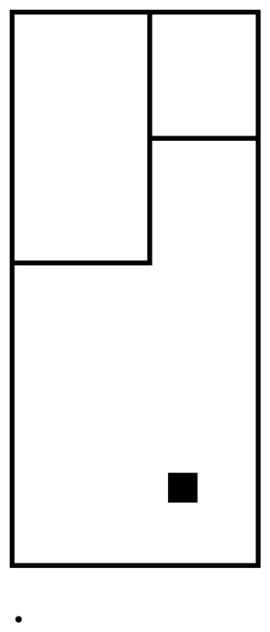

# Home Service Robot — autonomous pick-up and drop-off navigation (ROS / Gazebo)

Simulated mobile robot that navigates on its own between a **pick-up zone** and a **drop-off zone** in a custom Gazebo world, using SLAM, localization and path planning. Final project of the **Udacity Robotics Software Engineer Nanodegree** (2022).

## What it does

| Stage | Tools | Script |
|---|---|---|
| **Mapping (SLAM):** the robot is teleoperated while building a 2D occupancy map | `gmapping`, `turtlebot_teleop` | `scripts/test_slam.sh` |
| **Localization and navigation:** the robot localizes on the map and plans paths to manually set goals | AMCL, `move_base` (global and local planners, costmaps) | `scripts/test_navigation.sh` |
| **Autonomous mission:** a node sends two consecutive goals (pick-up, then drop-off) and reports the result of each | `pick_objects` (C++, `actionlib` client of `move_base`) | `scripts/pick_objects.sh` |
| **Virtual object (work in progress):** an RViz marker represents the object at the pick-up zone, to be removed when the robot reports reaching it | `add_markers` (C++, `visualization_msgs`) | `scripts/add_markers.sh` |
| **Full sequence** | navigation + mission + marker | `scripts/home_service.sh` |

## Packages in this repo

- `pick_objects/` — C++ node that sends the pick-up and drop-off goals to `move_base` and publishes the goal status on `/goal_status`.
- `add_markers/` — C++ node that subscribes to `/goal_status` and shows or removes the marker in RViz.
- `worlds/gustavo.world` — custom Gazebo world.
- `map/` — occupancy map (`map.pgm` + `map.yaml`, 0.01 m/pixel) used by AMCL.
- `scripts/` — shell launchers for each stage.

## Stack

ROS Kinetic (catkin) · Gazebo · RViz · TurtleBot simulator · gmapping · AMCL · move_base · C++

## How to run

1. Clone into the `src/` folder of a catkin workspace, together with `slam_gmapping`, `turtlebot`, `turtlebot_interactions` and `turtlebot_simulator`.
2. Build with `catkin_make` and source `devel/setup.bash`.
3. Update the world and map paths in `scripts/home_service.sh` (they currently point to the original workspace).
4. Run `./scripts/home_service.sh`.

## Known limitations

- `add_markers` is unfinished: `add_markers.cpp` (marker driven by `/goal_status`) still needs work before it builds and covers the drop-off stage, and `add_markers_test.cpp` (timed show/hide at both zones) is not yet registered in `CMakeLists.txt`. Mapping, localization, navigation and the `pick_objects` mission do not depend on it.
- The world and map paths are hardcoded to the original development machine.
